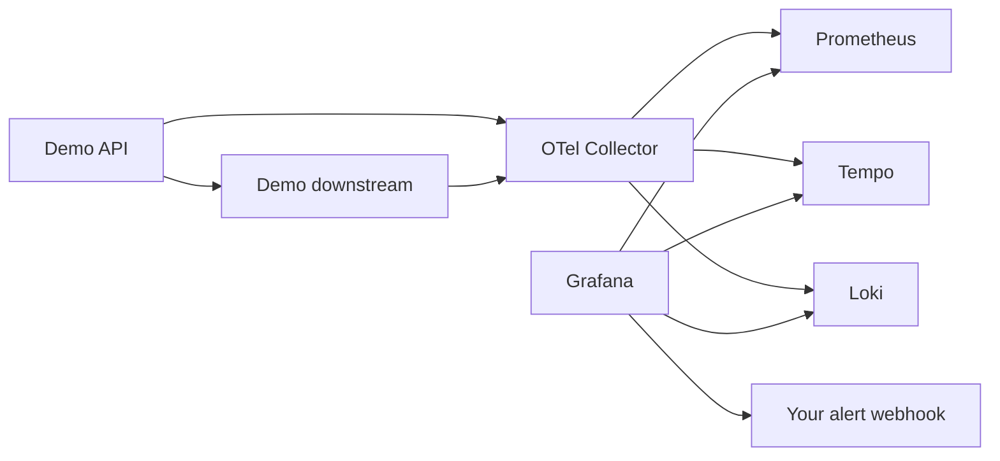

# OpenTelemetry observability starter for Railway

Collect application metrics, traces, and logs with OpenTelemetry, then explore them in Grafana. This starter includes Prometheus, Tempo, Loki, two instrumented Python services, and alerts with webhook delivery.

**Release status:** runtime validation is complete, including the 24-hour Railway soak and a fresh deployment from this repository. [Deploy the published Railway template](https://railway.com/new/template/opentelemetry-observability-starter). See [validation coverage](docs/validation.md).

## What you deploy

| Service | Version | Purpose |
| --- | --- | --- |
| OpenTelemetry Collector Contrib | 0.139.0 | Authenticated OTLP intake, batching, persistent export queues |
| Prometheus | 3.8.0 | Application metrics and Collector health metrics |
| Tempo | 2.9.0 | Distributed traces |
| Loki | 3.6.2 | Structured application logs |
| Grafana | 12.3.1 | Dashboards, Explore, log-to-trace links, alert evaluation |
| Demo API and downstream | Python 3.12 | Requests that produce all three signals across two services |



The Railway configuration creates seven services and five persistent volumes. Grafana is the only public service. Applications send telemetry over the environment's private network. Local Docker Compose also runs a test webhook receiver.

## Run locally

Prerequisites: Docker with Compose v2 and Python 3.

```sh
git clone https://github.com/DanielleWashington/railway-observability-starter.git
cd railway-observability-starter/stack
python3 scripts/bootstrap.py
docker compose up -d --build
curl http://localhost:8080/work
```

Open <http://localhost:3000>. Sign in with `GF_SECURITY_ADMIN_USER` and `GF_SECURITY_ADMIN_PASSWORD` from `stack/.env`. Older local stacks without a username variable keep `admin`. The bootstrap script preserves existing credentials and creates this file with owner-only permissions. Keep it out of version control.

Open **Dashboards → Application and telemetry pipeline**. In Explore, select Loki and query `{service_name="demo-api"}`. Expand a log record and follow **View trace**; the trace includes the downstream service. Allow a few seconds for export. Send more requests to see rates and latency.

## Deploy on Railway

The listing requires a workspace that supports at least five volumes and enough resources for seven running services. Usage is billed by Railway; no fixed monthly cost is promised. See [Railway volume limits](https://docs.railway.com/volumes).

Provide `Grafana.ALERT_WEBHOOK_URL`: an HTTPS receiver for Grafana's generic webhook JSON. Configure the receiver to accept `Authorization: Bearer <ALERT_WEBHOOK_TOKEN>` using the generated Grafana service variable. A Slack incoming-webhook URL is not a drop-in replacement for this contract.

After deployment, open Grafana's generated domain and retrieve its generated `GF_SECURITY_ADMIN_USER` and `GF_SECURITY_ADMIN_PASSWORD` from the service variables. The demo services remain private. Run requests from a service in the same environment, or connect your own instrumented application. See [configuration](docs/configuration.md) for variables, storage, and limits.

The intended template configuration is in [`stack/scripts/template_contract.py`](stack/scripts/template_contract.py). Each service uses its own `/stack/services/<name>` root; both demo services use `/stack/examples/demo`. The template supplies volumes, reference variables, health checks, and networking settings.

## Test

From `stack/`:

```sh
sh scripts/test-stack.sh
sh scripts/test-payloads.sh
sh scripts/test-recovery.sh
docker compose run --build --rm ui-tests
```

These checks exercise real storage backends, cross-service traces, metrics, logs, alert firing and resolution, persisted data after restarts, queued telemetry recovery, malformed and oversized OTLP requests, and Grafana navigation. The tests deliberately generate errors and temporarily stop backends. Run them in an isolated test stack.

For SDK integration tests, install `examples/demo/requirements.txt` in a virtual environment and run `python -m unittest discover -s tests -p 'test_*.py' -v`. GitHub Actions runs this suite and the Docker checks on pushes and pull requests.

For optional load and retention checks, see [testing](docs/testing.md).

Stop the local stack with `docker compose down`. Volumes remain available for inspection. Adding `--volumes` deletes stored telemetry and Grafana state.

## Scope and license

This is a single-replica evaluation starter using local volume storage. It does not include high availability, object storage, backups, or automatic collection of Railway host metrics and service stdout. Instrument your application to emit OTLP signals. Set application-specific alert thresholds and storage limits before sustained use.

Repository code is licensed under [MIT](LICENSE). The third-party images and dependencies retain their own licenses; MIT does not relicense them. See [third-party components](THIRD_PARTY.md).
